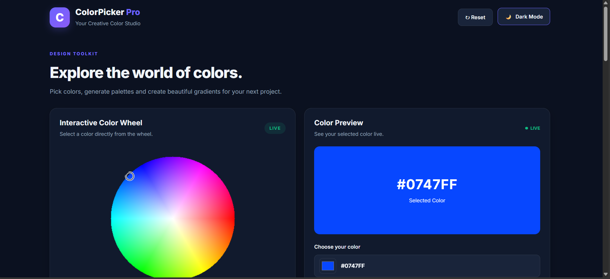
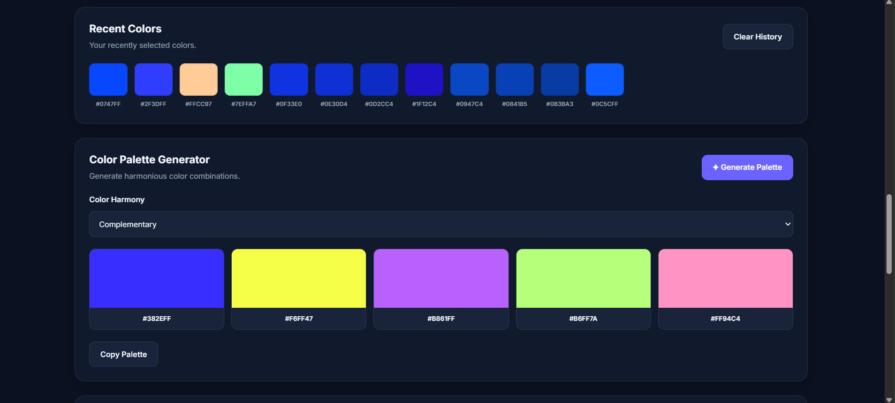
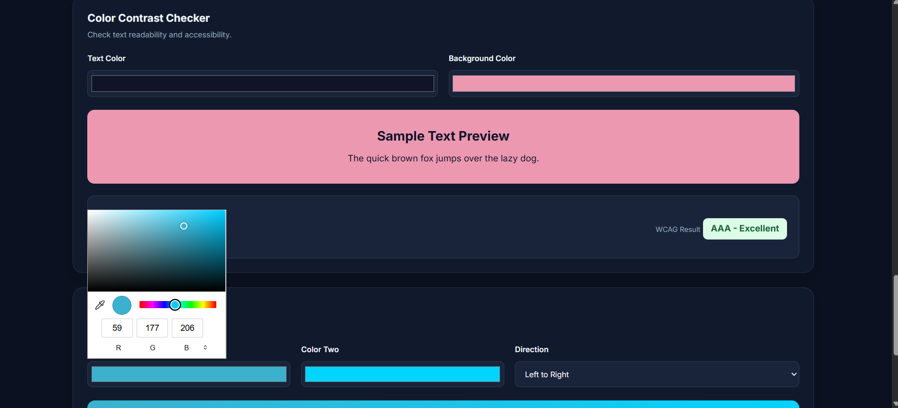
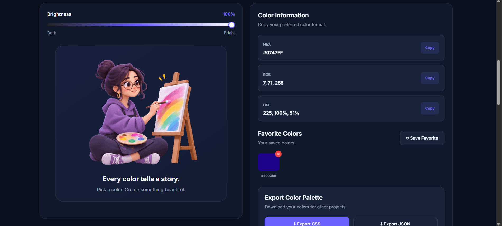

# 🎨 ColorPicker Pro – Color Studio

A modern, interactive color picker and palette generator built using **HTML, CSS, and JavaScript**. ColorPicker Pro helps developers and designers explore colors, generate harmonious palettes, check color accessibility, and create beautiful gradients.

## 📸 Screenshots

### ColorPicker Pro – Main Interface

<table>
  <tr>
    <th>Interactive Color Wheel</th>
    <th>Color Palette Generator</th>
  </tr>
  <tr>
    <td width="50%">
      
    </td>
    <td width="50%">
      
    </td>
  </tr>
</table>

### Color Accessibility & Creative Studio

<table>
  <tr>
    <th>Color Contrast Checker</th>
    <th>Artist Illustration</th>
  </tr>
  <tr>
    <td width="50%">
      
    </td>
    <td width="50%">
      
    </td>
  </tr>
</table>

## ✨ Features

- **Interactive Color Wheel** – Select colors visually using the color wheel.
- **Live Color Preview** – Preview selected colors instantly.
- **HEX, RGB & HSL** – View and copy color values in different formats.
- **Brightness Control** – Adjust the brightness of selected colors.
- **Random Color Generator** – Generate random colors with one click.
- **Favorite Colors** – Save and manage your favorite colors.
- **Recent Color History** – Quickly access previously selected colors.
- **Color Palette Generator** – Generate harmonious color combinations.
- **Color Contrast Checker** – Check contrast ratios and accessibility.
- **Gradient Generator** – Create custom gradients using multiple colors.
- **Export Options** – Export color palettes as CSS or JSON.
- **Dark & Light Mode** – Switch between themes.
- **Responsive Design** – Works across desktop, tablet, and mobile screens.
- **Animated Illustration** – Includes a creative artist GIF.

## 🛠️ Technologies Used

| Technology | Purpose |
|---|---|
| HTML5 | Structure and layout |
| CSS3 | Styling, animations, and responsive design |
| JavaScript | Interactive functionality and color calculations |
| Canvas API | Interactive color wheel |
| Local Storage | Persist supported user preferences and color data |

## 📂 Project Structure

```text
ColorPickerPro/
│
├── index.html
│
├── css/
│   └── style.css
│
├── js/
│   └── script.js
│
├── images/
│   └── artist-painting.gif
│
├── Screenshots/
│   ├── Color wheel.png
│   ├── Color palette.png
│   ├── contrast checker.png
│   └── Gif.png
│
└── README.md
```

## 🚀 Getting Started

### 1. Clone the repository

```bash
git clone https://github.com/YOUR_USERNAME/ColorPickerPro.git
```

### 2. Navigate to the project directory

```bash
cd ColorPickerPro
```

### 3. Open the project

Open the project folder in Visual Studio Code.

### 4. Run the application

Install the **Live Server** extension in VS Code.

- Right-click `index.html`.
- Select **Open with Live Server**.
- The application will open in your browser.

## 🎯 Project Purpose

The purpose of ColorPicker Pro is to provide an easy-to-use color tool for developers, designers, and creative professionals.

This project helped me improve my understanding of:

- DOM manipulation
- JavaScript event handling
- Color conversion algorithms
- Canvas API
- CSS Grid and Flexbox
- Responsive web design
- Browser storage
- Accessibility and contrast ratios

## 🔮 Future Enhancements

- Color name identification
- Color palette sharing through URLs
- Image-based color extraction
- Advanced accessibility recommendations
- More export formats
- Custom palette collections

## 👨‍💻 Author

**Sunil J S**  
Java Full Stack Developer | BE Computer Science & Engineering

- **GitHub:** [Sunilgowda2003](https://github.com/Sunilgowda2003)
- **LinkedIn:** [Sunil J S](https://www.linkedin.com/in/sunil-j-s-7b5435286/)

## ⭐ Support

If you like this project, consider giving it a ⭐ on GitHub!

---

**ColorPicker Pro – Explore colors. Create something beautiful.**